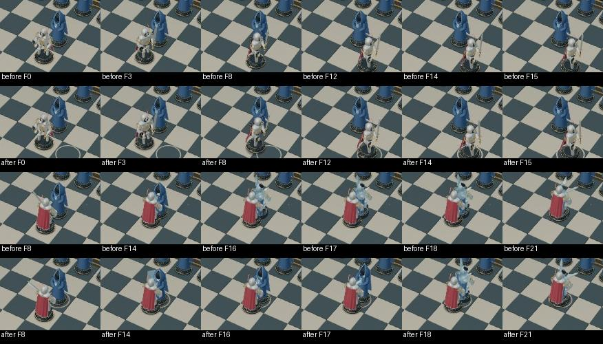
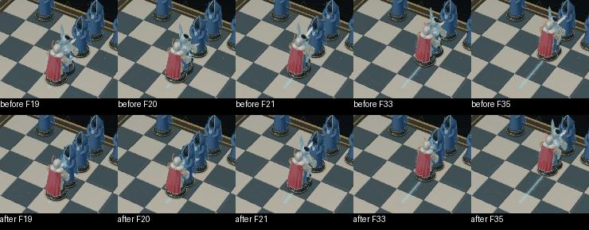

# 落子与命中演出 · 0.8.1

[打开同机位动作对照](https://suducat.github.io/shadow-king/review/motion/)

基线为干净的 main 提交 `4577518`。在 Chromium 156 的 WebGL 棋盘上通过鼠标操作，先录旧版，再重放相同的红方局面。两版都使用 1080 × 720 窗口、DPR 1、低画质、默认缩放和固定镜头。

| 动作 | 基线观察 | 修改后的逐帧记录 |
| --- | --- | --- |
| 影卫从 D4 到 E4 | F3 起步。F12 已触发落地声，此时仅走完 90.4%，F15 到格。提交移动时落点环消失。 | F3 起步，重心先压低，接着底座离地；F14 达到格心并触地。石面短音、底座承重与金色落点环共用落定时刻。 |
| 影卫从 D4 吃 D5 | F5 起步，F16 命中时蓝方封印立即替换为影卫；右侧战报在提交时已经更新。 | F8 起步；F16 命中、闪光并触发声音。F17 仍见封印受力，F18 揭示并更新战报，F24 到格。 |
| D4 向 D5、D6 斩杀 | F8 起步，F19、F33 接触两个目标，两个封印都在各自命中帧直接换模。 | F8 起步，F19、F33 分别命中，F21、F35 分别揭示，F37 到最终格。两个目标各自回收。 |

帧号从零开始，指动作时钟上第一个达到该阶段的 1/30 秒采样帧。起步取底座首次水平位移，到格取抵达格心。浏览器逐帧绘制的影片可同步慢放；每组另附实际运行时的 WebM 及 Web Audio 原声。





## 实现与验证

- `battle-timeline.ts` 定义接触、受力后的公开、落定与收势。`scene.ts` 按已跨过的时间点播放，跳过仍能完整清理。规则引擎只结算一次。
- `models.ts` 与 `battle-effects.ts` 从实物剑刃、权杖和法器取样。影卫与王共享短剑光轨迹的实现，各自使用不同的发力与接触姿态；死士的符印光束跟随能量前端，直到命中才到达目标。未知身份统一使用封印姿态与音色。
- `board-marks.ts` 复用一个落点环，`audio.ts` 用短石面接触和低频共鸣表现落定。`App.tsx` 的战报、身份提示和棋盘状态随演出更新。
- WebGL 动作探针完成 50 次动作及 129 项检查，涵盖三种角色的四方向普通吃子、封印受力先于揭示、斩杀顺序、状态取消和资源回收。王的权杖接触点与目标中心水平距离约 0.098 格，影卫约 0.083 格。
- 普通攻击保留 40 毫秒接触停顿；斩杀每次接触停顿 32 毫秒。软件渲染降至 3 FPS 或后台恢复时，跨过的里程碑按序处理。实际能显示多少中间姿态取决于设备帧率。
- 实测环境为 Linux Chromium / SwiftShader。手机输入使用 390 × 844 触控模拟。实时采集受到软件 GPU 限制，每条原声片实际编码 3–7 个视频帧；逐帧采样用于检查姿态与时间顺序。Mac、实体手机与硬件 GPU 的帧率仍待实测。
- 正式主 JS 从 265.08 kB 增至 266.09 kB（Vite gzip）。对照媒体仅在打开对照页时加载。

## 复验命令

```sh
npm test
npm run build:test
node tests/combat-browser.cjs --probe-only
node tests/motion-browser.cjs
node tests/combat-background.cjs
npm run build
npm run test:combat:production
node tests/combat-production.cjs --restart
```

录屏脚本使用 Playwright、Chromium 与 FFmpeg。保留旧版测试构建目录后，分别传入旧版与新版目录即可从相同局面重录。

```sh
node scripts/motion-review.cjs before /path/to/old/dist-test
node scripts/motion-review.cjs after dist-test
node scripts/motion-live.cjs before /path/to/old/dist-test
node scripts/motion-live.cjs after dist-test
```

本次运行通过 142 项单元测试。桌面鼠标和手机触控模拟分别检查命中前的战报、受力后揭示、跳过、交接和动作中返回主菜单。Chromium 冻结 2300 毫秒后恢复，双目标斩杀共推进一步、产生两次吃子和两次命中，过期命中声为零。
