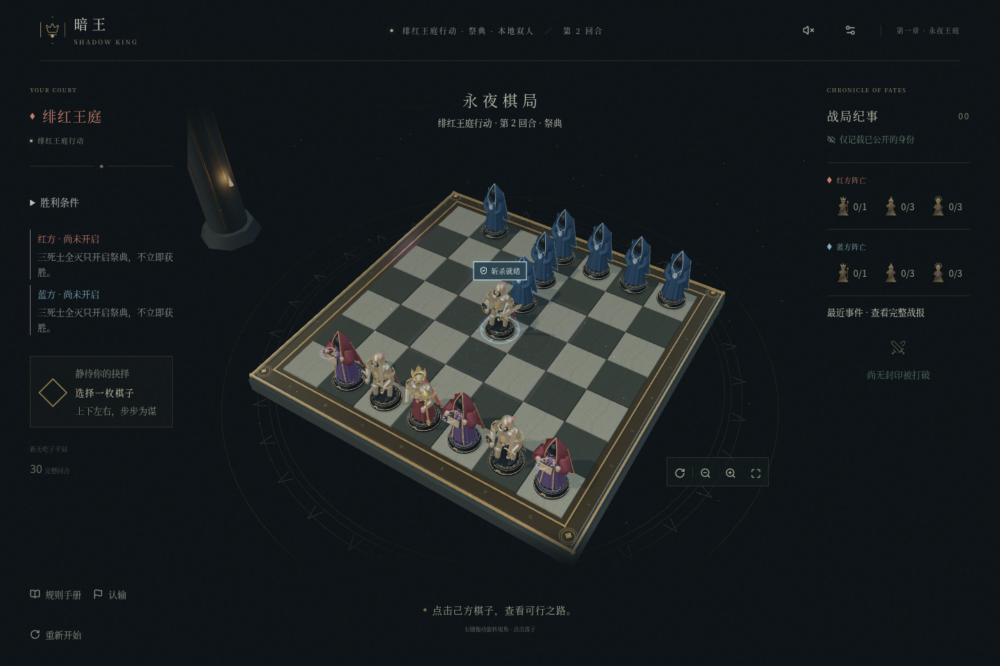
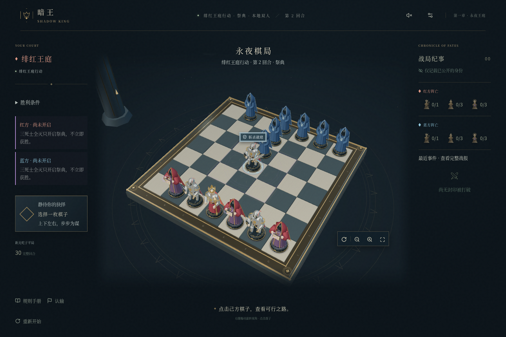
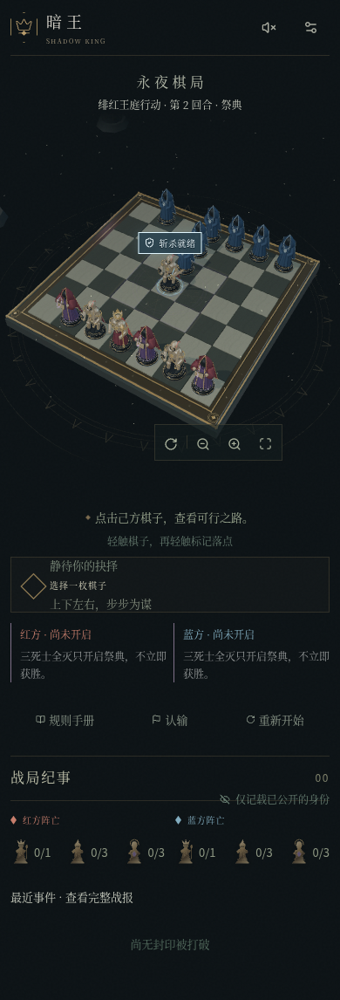
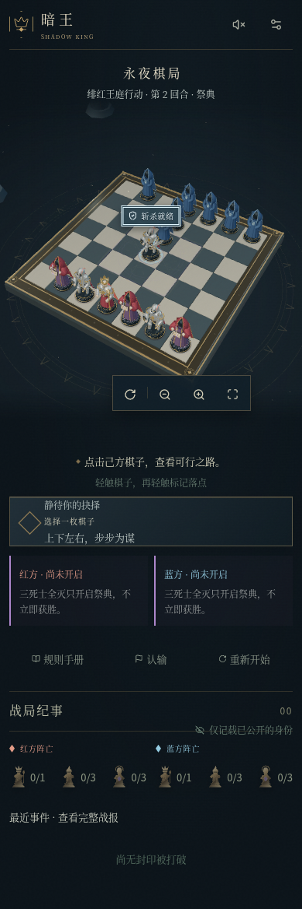

# 《暗王》V0.6：全知者与棋具精修验证报告

正式站点：https://suducat.github.io/shadow-king/ 。本报告不把“近乎不可战胜”当作已经证明的结论。

## 交付与权限

第五档为「全知者 · 帷幕之外 · 终极挑战」，卡片展示“全身份透视”，选择后醒目说明：

> 全知者能够看见你的全部棋子身份。你仍无法看见它尚未公开的身份。

它有独立开始挑战按钮、对局顶部持续标记和规则面板说明。鼠标、键盘选中状态和390px触控均已验证。重开／再来一局保留难度，切回原四档撤销透视。原四档和本地双人保留，`game.ts`、`ritual.ts` 未改动。

只有观察生成函数显式授权才传递完整角色和准确重复局面计数。Worker 再次核验；原四档强制遮蔽。界面、无障碍棋盘、角色、战报仍使用独立的 `viewFor`，不从全知观察读取角色；没有修改 `revealed` 或制造公开事件。模拟玩家的行动概率只根据其自身身份、公共位置、明牌、战报及合法身份假设生成；不是双方都全知。测试覆盖不透明随机ID，决策不靠固定ID或布阵列猜身份。

## 搜索瓶颈与改进

原大师为最多四层的有限采样搜索，普通走法较早被裁剪。第五档使用独立搜索，完整检查全部根合法行动及立即胜败、完整祭典回应证书；迭代加深、走法排序、保留强制战术分支、晚期普通行动降深及改善时重搜、有限置换缓存。历史信息参与缓存键，因此命中率可能较低，不能把算法名当成棋力证明。

评估增加王的退路、两格围堵、非王棋子协同追击、影卫目标、蓄力暴露、死士与祭台时机和反重复。布阵使用更偏好护王结构的合法加权分布，仍保留多种布局，不读取玩家布阵。更具体的实现与限制见 [架构说明](ARCHITECTURE.md)。

初版24局保留了2场祭典败局；复盘发现王过早承担追击、公开蓄力影卫被直接吃掉等问题。最终版改进后使用相同全部种子重测。两场初版败局最终回合的全部合法行动都已无法避免立即败局，失误发生在此前的布置；详见 [败局复盘](data/initial-loss-review.json)。没有移除失败样本或针对单个种子写特殊走法。

## 实战测试

主测试实际运行 Chromium 模块 Worker，使用网页原样预算：常规1900ms、复杂4200ms、最大110000节点，未使用无限时间。原大师保持650ms／5000节点上限。每组固定种子63017、70936，交换红蓝先后手，双方按各自生产布阵策略部署。经典／祭典分别对当前大师、死士前压、守王三种对手，共24局，全部自然终局，没有非法行动、失败任务或240步截断。

这两个风格基线是固定启发式策略，不能代表强人类棋手。前压基线主要推进死士，守王基线偏好护王与空间控制；它们不读取敌方暗身份。可复现工具见 `scripts/v06-arena*`，原始记录保留每一步、角色公开事件、初始布局、结果、逐步思考时间与 Worker 指纹。严格墙钟截断受设备负载影响，固定种子保证输入配对，不能保证再次搜索逐步相同；保存的行动记录可按规则确定性重放。

|模式|对手|样本|全知者胜/负/和|直接胜率 Wilson 95%区间|全知平均/P95搜索|
|---|---|---:|---:|---|---|
|经典|无冕者（当前大师）|4|2/0/2|15.0%–85.0%|2134/4202 ms|
|经典|死士前压基线|4|4/0/0|51.0%–100.0%|2622/4200 ms|
|经典|守王基线|4|4/0/0|51.0%–100.0%|1697/1905 ms|
|祭典|无冕者（当前大师）|4|2/0/2|15.0%–85.0%|2810/4202 ms|
|祭典|死士前压基线|4|4/0/0|51.0%–100.0%|2171/4204 ms|
|祭典|守王基线|4|4/0/0|51.0%–100.0%|1765/4200 ms|

合计 **20胜、0负、4和**，直接胜率83.3%，描述性95%区间 **64.1%–93.3%**；和棋按半分计算得分率91.7%。经典与祭典各10胜、0负、2和，分别的直接胜率区间均为55.2%–95.3%。全知者执红先手11胜1和；执蓝后手9胜3和。

对大师合计4胜4和，得分率75%。每种模式仅4个样本，配对局彼此相关，**不足以证明统计显著压制、对所有玩家很强或不可战胜**。此处区间为本组直接胜局数／全部对局数的 Wilson 描述区间，和局保留在分母，不能当作独立人类玩家总体推断。

最终版终局：弑王16、经典献祭2、祭典2、肃清0、和棋4（静默3、重复1）。肃清规则在夹具与重放中正确，不因本批触发次数少而修改平衡。平均55.04步／局。零败局不代表不会被击败，初版败局也全部公开。

全知者663次实际搜索，平均 **2.439s**、中位 **1.900s**、P95 **4.201s**、最大 **4.280s**。大师528次搜索平均128.3ms，P95 349.7ms，最大680.1ms，通常先达到节点上限。

380ms最短选子展示及200ms选中反馈与实际搜索分开；复杂搜索不再额外等待380ms。搜索、规则模拟及已检查的回退均在Worker中。实际5.6秒看门狗测试验证了只采用一次预先返回的回退、终止Worker、拒绝迟到结果；软件GPU的画面调度及动画时间另计，不属于思考时间。

数据：[最终24局](data/final-arena.json) · [初版24局含败局](data/initial-arena.json) · [统计与指纹](data/summary.json)。126项单元测试包括全部48局逐步重放，确认每步合法、无终局后行动、无重复棋子或格子重叠。

## 视觉与画质

保留已有角色、棋盘、全部动作、身份揭示、胜利演出与音效。统一黑曜石、旧金、暗红、冷蓝，紫色用于祭典。原创矿物细粒、金属粗糙度与织纹分开处理；皮肤从原来偏高金属度改为非金属材质，铠甲保持金属边缘反光。王冠、武器轮廓和底座细槽更清楚。暖主光、冷轮廓光、较低曝光与适量环境光保留暗部结构。

棋盘使用实例化格子、坐标图集；边框、柱体按材质合批；环境尘埃低密度。未加入景深、强泛光或重型后期。原封印模型始终由可见身份生成，未公开敌方各身份共用相同几何、材质、尺寸、阴影和待机规则。

|画质|曲面横纵采样系数|像素比上限|阴影与细节|环境尘埃|
|---|---:|---:|---|---:|
|高|1.0|1.5|1024动态阴影、微纹理、完整雕刻|100|
|中|0.75|1.25|简化接触投影、微纹理、平衡雕刻|55|
|低|0.45|1.0|简化接触投影，省略角色微纹理采样；保留全部关键状态|20|

默认桌面中档；触控或不超过4逻辑核的设备低档。系统减少动态效果决定初始精简动画偏好，可在设置中覆盖。低档保留选中、移动圆点、攻击交叉、蓄力、斩杀箭头、三角危险标记、祭台和占领状态。手机技能采用底部上下文面板，不遮挡棋盘，触控按钮不少于44px。

画质变更延迟到战斗完成后再替换角色模板，稳定ID和独立可变材质仍保留。模型压力验证通过108次普通移动、30次吃子、33次跳过、27次重开，60/15/3 FPS模拟时间步；包含连续双斩、途中胜利、途中开启祭典、攻击者／受害者移除与中途切换画质。未发现只剩底座、主体不可见、重复角色、残留攻击或坐标不同步。开发期间修复了本轮静态合批时索引格式不兼容造成的Three警告。

## 实测设备与性能限制

环境为Linux云端、AMD EPYC 9V74宿主，容器CPU配额约2核，浏览器报告3逻辑核；Chromium156、ANGLE Vulkan **SwiftShader软件渲染**。桌面1440×960；手机为390×844触控模拟，**不是真机**。均DPR1。更新前基准为仓库提交`a36b6b5`，只增加不可见的帧计数器；未更改其视觉或规则。基准关闭精简动画、使用同一`ready`祭典夹具、相同相机，预热后至少观察8秒，按真正renderer渲染帧计数，不用rAF回调冒充绘制帧。性能测量顺序执行，无AI对战或其他WebGL测试并行。

|版本/画质|视口|实际绘制帧/耗时|观察FPS|draw calls|三角形|
|---|---|---|---:|---:|---:|
|before|desktop 1440×960|6/9.49s|0.63|544|338,762|
|before|mobile 390×844|8/8.28s|0.97|553|338,986|
|after|desktop 1440×960|7/8.81s|0.79|426|240,810|
|after|mobile 390×844|13/8.57s|1.52|425|240,794|
|after-low|desktop 1440×960|10/10.24s|0.98|426|145,780|
|after-low|mobile 390×844|19/8.34s|2.28|425|145,764|
|after-high|desktop 1440×960|6/9.50s|0.63|426|346,762|

软件GPU上仍不流畅，以上结果**不能证明Mac、Retina或实体笔记本达到流畅帧率**。尚未实测Mac Safari、真机iPhone/Android、集成GPU硬件或长时间发热。高画质阴影在该环境最昂贵，建议低配选择低档或精简动画。样本短、云端调度有波动，FPS仅是本次环境观察，不是稳定性能承诺。

加载体积（完整静态游戏资产，不含许可文本，字体仍本地提供）：原始 **1,245,532 → 1,273,119 bytes**，变化 **2.21%**；逐文件gzip估算 **545,170 → 553,880 bytes**，变化 **1.60%**。这不是实际网络测速，Pages压缩/缓存可能不同。构建仍有原有主JS包超850kB提示，未为此进行大规模拆分。

## 同场景前后截图

桌面与手机均为同一`ready`局面，相同视角和DPR；最终版中画质。点击图片可查看原尺寸。

|桌面更新前|桌面更新后|
|---|---|
|||

|手机更新前|手机更新后|
|---|---|
|||

其他截图：[第五档桌面卡片](screenshots/desktop-challenge.png) · [第五档手机卡片](screenshots/mobile-challenge.png) · [祭典开启](screenshots/v04-altar-open.png) · [占领与回应](screenshots/v04-occupied.png) · [斩杀](screenshots/v04-execution.png) · [手机技能面板](screenshots/v04-touch-charge.png) · [低画质](screenshots/after-low-desktop.png) · [高画质](screenshots/after-high-desktop.png)。

## 验证与修改文件

- `npm test`：126项通过，含信息隔离、身份置换、不透明ID、立即胜利、唯一防败、祭典完整回应、经典／祭典规则与48局公开记录重放。
- `npm run build`：TypeScript与正式构建通过；生产包不包含开发夹具入口。
- `tests/v06-browser.cjs`：桌面／手机、键盘、五卡告知、真实Worker、只走一步、无身份泄露、重开／切档、三种攻击者、双斩与胜利、旧任务强行送达均通过。
- `tests/v06-production.cjs`：实际生产bundle在`/shadow-king/`子路径加载，经典／祭典本地双人及全部五档Worker行动通过，0缺失请求、0控制台错误。
- `tests/v06-render.cjs`与`tests/v04-browser.cjs`：模型生命周期压力、三档切换、完整动作、祭典与占领提示、鼠标／触控、固定两格斩杀和友军阻挡均通过。
- `tests/v06-watchdog.cjs`：真实5.6秒超时，采用Worker预检查回退一次并忽略迟到结果，通过。

主要文件：

|文件|改动|
|---|---|
|`src/ai.ts`, `ai.worker.ts`|第五档、显式观察权限、Worker边界、预先回退|
|`src/omniscient-ai.ts`|独立完整身份搜索及公开信息的模拟玩家策略|
|`src/useAI.ts`, `ai-deployment.ts`|取消、超时、可靠回退及挑战布阵|
|`src/App.tsx`, `OpponentSelect.tsx`|卡片、告知、持续标记、规则说明、画质设置、祭典提示|
|`src/scene.ts`, `models.ts`, `surfaces.ts`, `quality.ts`|材质、灯光、雕刻、实例化／合批、分档与安全资源替换|
|`src/BoardHUD.tsx`, `polish.css`, `main.tsx`|危险形状、手机技能面板、字体层次与按钮反馈|
|`src/strategic-ai.ts`|类型区分普通四档，原算法不变|
|`tests/*v06*`, `omniscient.test.ts`, `quality.test.ts`|单元、重放、生命周期、Worker、生产子路径检查|
|`scripts/v06-*`, `docs/v0.6/*`|真实预算对战、原始数据、复盘、统计、截图与性能工具|
|`README.md`, 包版本、许可说明、release workflow|V0.6说明与分发记录；现有Pages流程保留|

## 仍存在的弱点

1. 大师后手对局仍有长和棋；重复规避与远程包围不等于强制求胜。尚未证明达到“近乎不可战胜”，也未证明对大师统计显著优势。
2. 模拟玩家是有限身份假设与有噪声策略，不能穷尽心理欺骗或高水平人类策略。两组种子和两类简单基线的覆盖有限。
3. 本批肃清结算为零，规则正确但主动肃清规划仍值得加强；未擅自改变任何胜负条件。
4. 未完成真机与Mac硬件性能验证，软件GPU帧率低；高画质仍较昂贵。保留主包体积警告，没有用模糊或过暗遮掩模型。
5. Worker连预检查回退都无法生成的异常失败路径，只能恢复一个合法行动；不保证该异常行动有同等棋力。

新增美术为原创程序纹理／几何和现有Lucide（ISC）图标，原字体OFL许可保留。不含外部付费依赖、密钥或训练场个人对局数据。上线检查记录由现有GitHub Pages工作流与公开URL确认。

## 线上部署确认

运行代码提交：`323a73967bc27ce0734d872a13e289274d535df3`。[Pages发布成功](https://github.com/suducat/shadow-king/actions/runs/43866183873) · [CI测试与构建成功](https://github.com/suducat/shadow-king/actions/runs/43866183808)。公开URL返回200，线上主JS及Worker与本地正式构建逐字节一致，Worker指纹与24局实际预算测试相同。后续证据文档补充不改变游戏产物。

通过公开站点实际进入第五档、确认布阵、完成玩家与AI各一步，并确认回到玩家回合；实际收到独立Worker决策，搜索1.901秒、28,632个搜索／策略评估节点，完成深度4。这是一次上线检查，不是额外的强度样本。无控制台错误或缺失资源，生产页面无开发夹具。

云端Chromium的代理证书需要仅测试上下文的`CLOUD_PROXY_TLS=1`选项；curl保持默认TLS验证，确认公开站点与资产。正式游戏没有更改TLS设置。

[上线检查原始记录](data/deployment.json) · [线上桌面截图](screenshots/live-desktop.png) · [线上手机截图](screenshots/live-mobile.png)。线上截图采用低画质、DPR0.5；同场景前后比较仍为前述DPR1图像。
