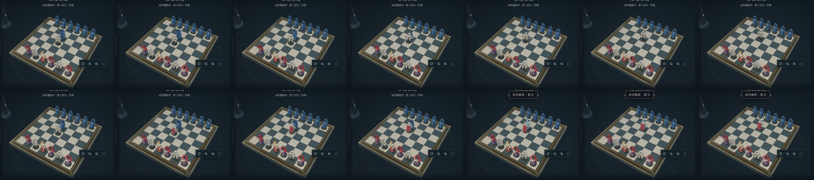

# V0.7 · 角色动作与战斗演出

正式项目 suducat/shadow-king 原地更新；对照版本 2765ae7。规则引擎、落点判断、AI 搜索与 AI_BUILD_ID v0.6.0 均未修改。UI 发行版本为 0.7.0。

## 实际对照

- [前后实时录屏、完整界面、棋盘原声](https://suducat.github.io/shadow-king/review/v07/)。相同的 13 组操作，包括三角色移动、三角色吃子、双目标斩杀、蓄力、祭典开启，以及弑王／肃清／经典献祭／祭台胜利。
- [原版设置与场景记录](../../public/review/v07/before-reel.json)、[新版设置与场景记录](../../public/review/v07/after-reel.json)。两者均明确关闭精简动画、启用动作音效。
- 下图上排原版、下排新版，进度依次 0、.20、.40、.58、.62、.78、.93。它是浏览器固定进度截图，不是实时 FPS；实时表现以上方视频为准。

初次录制发现测试工具在 reload 时覆盖偏好、误用了精简动画；已修正工具，重新录制并断言设置。初次录屏和零 FPS 静止采样已弃用，不在交付数据中。完整界面影片没有音轨；Canvas 原声影片以同一个 MediaRecorder 录下画布及 Web Audio，包含同步音轨。25 FPS 是视频编码率，不能当作游戏渲染帧率。

## 原因与实现

1. 原普通吃子在动作进度 .40 就开始消失，而根节点位移此时仅完成约 4.4%；攻击音也在落子提交时就播放。武器围绕固定轴摆动，没有面向目标。现由统一时间轴驱动预备、发力、接触、余势、归位；普通命中在 .58，武器与目标先接触，受击者再退出。
2. 原整枚模型上下浮动，包括底座。现在底座保持贴地，加入身体重心、影卫双腿、披风、双臂、武器和王冠关节；武器归属于握持手臂。姿态每帧从绑定姿态绝对采样，避免增量漂移。普通移动 580–740ms，公开角色普通攻击 880–1080ms；双格斩杀 1440ms，精简动画每格 100ms。
3. 影卫以剑刃实际世界位置生成轨迹，四方向普通斩击距离目标中心约 .083 格，双目标斩杀约 .080 格（在目标身体范围内）。王用权杖和短距离能量传导，死士用法器、封印汇聚；未知敌方统一封印动作、冷灰色能量与统一声音。仅规则捕获输出允许目标在命中后公开身份，不读取隐藏身份来挑演出。
4. 命中采用 32–40ms 表现停顿、局部光点、定向碎屑、小范围地面环与最多 .018 世界单位镜头反馈。普通行动保持短演出。王退场浮起倾斜王冠；影卫失衡折膝、武器下垂；死士封印收束、袍身俯落；封印体统一瓦解。底座最后退出，整枚对象统一释放，不把存活攻击者的模型或材质交给退场逻辑。
5. 规则状态立即由原内核决定，时间轴只负责表现。捕获时暂留受击者的公开表现快照，解决了“蓄力符文提前丢失／祭台在命中前瓦解”。多目标依次消费命中事件；跳过与后台长间隔仍消费全部事件一次，过期命中声响与闪光不补播，祭典等持久状态随最终棋局更新。取消使用动作组 ID 清理声音、镜头与特效。
6. 蓄力包含举剑、聚能和持续标记；剑光跟随武器世界变换。祭典开启、占领汇聚和占领被打断有独立的环形过渡及声音。弑王以王冠断裂为高潮；肃清三道守护逐个熄灭后法阵崩解；经典献祭三印同时归一并展开法阵；祭台胜利以九格、回应防线和王冠登临分段。实际终局原因决定演出，认输另用垂落王旗。结算可跳过；减少动态效果使用静态收束画面、关闭震屏和强闪。
7. 音效按低频力量、材质噪声、能量音和短空间尾响分层；缓存噪声和混响，限制 12 个声部，事件键去重，取消与节点结束显式断开连接。命中碎屑低档 6 个、其他档 8 个，用一个 InstancedMesh 绘制；瞬态组最多 6 个，最多两个斩杀残影，并释放实例缓冲、几何体和材质。

## 修改文件

- src/models.ts：关节层级、武器握持、独立底座／身体／王冠材质域、绝对姿态恢复。
- src/battle-timeline.ts：动作采样、命中停顿、公开事件、幂等里程碑、结算时钟。
- src/scene.ts：面向目标、连续目标表现、接触后公开与退场、取消、跳过、镜头及音效排队。
- src/battle-effects.ts：真实武器轨迹、局部命中、受控实例碎屑、祭典阶段及资源回收。
- src/EndCinematic.tsx、src/combat.css：四类阶段高潮、同步声音、跳过及精简画面。
- src/audio.ts：合成音层、限幅、短混响、声部组与去重、节点回收。
- src/App.tsx、src/main.tsx：接入公共命中事件、消除提前／重复音效、清理重开／离开任务。
- src/combat-qa.ts、tests/combat*、tests/support.cjs、scripts/v07-*：测试与录像工具；QA 模块仅进入 test 构建。测试偏好现在由调用者明确注入。

## 已执行的验证

| 验证 | 实际结果 |
|---|---|
| npm test | 134 / 134，通过；含原规则、斩杀、AI 观察隔离和新增时间轴测试 |
| 新浏览器姿态／生命周期检查 | 101 项、50 次动作；失败 0 |
| 时间步长 | 60 / 15 / 3 FPS 及一次跨过全部事件；每个斩杀命中各处理一次 |
| 原交互与生命周期回归 | 108 移动、30 吃子、33 跳过、27 场景重开；失败 0 |
| 原多角色材质回归 | 216 移动、42 吃子、9 中断；失败 0 |
| 角色可见性 | 存活主体、底座、逻辑坐标和模型引用一致；攻击者材质保持独立 |
| 敌方隐私 | 三种真实身份被遮蔽后，实际动作角色、时长、身体姿态和事件表相同 |
| 声音压力 | 重复键拒绝；上限 12 声部／42 音源；最终 0 活动音源，峰值 0.34，无非有限样本 |
| 连续资源回收 | 16 轮不同棋子数量场景交替；几何体在 281／301 间切换、纹理 5，不随轮数增长 |
| 正式构建完整经典对局 | 布阵到蓝方弑王，8 步；跳过一次动作、跳过终局，无控制台错误 |
| 正式构建完整祭典对局 | 独立祭典规则下布阵到蓝方弑王，8 步；跳过动作与终局，无控制台错误 |
| 正式构建重开 | 实际移动→认输→再来一局→重新交换布阵，正常 |
| 四种终局演出 | 弑王、肃清、经典献祭、祭台胜利均通过实际行动触发并录制；前三种另验证跳过、重开 |
| 触控 | 390×844 仿真，真实 touchscreen.tap；蓄力、公开、禁用斩杀原因和面板边界正常 |
| 正式构建 | npm run build 成功；无测试入口；保留原有大包体提示 |

完整生产对局测试的第一次跳过尝试曾因 Playwright 等待按钮稳定时动画已经自然结束而超时，控制台无错误。最终回归改为在 DOM 按钮出现时调用它的实际 click 处理器；棋盘移动仍使用鼠标投影点击，不延长游戏动画来迁就测试。上表使用最终通过结果。资源计数证明这些场景有界，不代表对所有浏览器堆内存作出保证。

## 性能与体积

实测：Mozilla/5.0 (X11; Linux x86_64) AppleWebKit/537.36 (KHTML, like Gecko) HeadlessChrome/156.0.0.0 Safari/537.36；3 逻辑核，ANGLE (Google, Vulkan 1.3.0 (SwiftShader Device (Subzero) (0x0000C0DE)), SwiftShader driver)。1024×768，DPR .65，低画质，14 子，同一局面；关闭精简动画。前后顺序运行，三个各约 3 秒的连续渲染样本。

| 指标 | 原版 | 新版 |
|---|---:|---:|
| 三段实际 FPS | 1.66 / 2.66 / 2.33 | 1.65 / 2.99 / 2.33 |
| 中位 FPS | 2.33 | 2.33 |
| 静态棋盘 draw calls | 278 | 339 |
| 三角形 | 143912 | 143912 |
| 正式入口 JS+CSS 原始字节 | 975871 | 995616 |
| 正式入口 JS+CSS gzip 字节 | 273558 | 280359 |

关节拆分增加 61 次 draw call，约 22%，三角形未增加；此软件显卡采样的 FPS 约 2.33，不能据此宣称性能提升或笔记本流畅。正式入口压缩体积增加 6801 字节（约 6.6 KiB）；Worker 和资源依赖未增加。对照媒体约 5.3 MiB，独立比较页按需加载，正式游戏不请求这些视频。

实际原声影片在 effects=.55、music=0 时，原版峰值 -10.5 dBFS，新版 -19.7 dBFS；新版有意保留音量余量，不宣称更响。原声以及离线压力峰值都已检查，没有进行真实耳机／扬声器听感验收。

## 仍有的限制

- 仅实测上述云端软件显卡与触控仿真，未测 Mac、Safari、手机真机及真实扬声器；不能完成这些设备的流畅度或听感验收。
- 动作为程序化关节动画，没有全身骨骼步态、足部 IK 或布料物理。长袍角色主要通过重心、武器和衣摆表达重量。
- 云端实时录屏帧率很低，已补充固定进度画面核对接触与退场，但不能把它冒充高帧率实时展示。draw call 增幅仍需真机评估。
- 没有新增第三方人物、影视音频、密钥或付费运行依赖；保留原创程序化模型、材质和 Web Audio。
